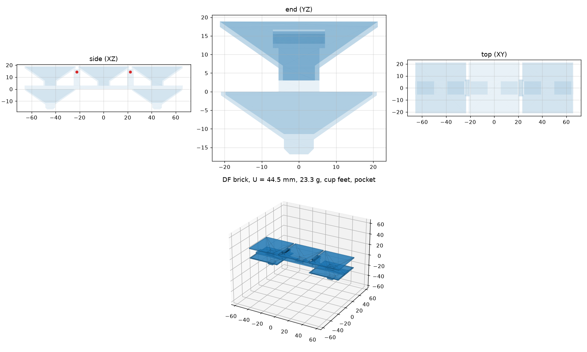

# DF-brick: distributed-funnel bricks

A new brick family (issue #42), designed against the drone's **measured** approach error from
Experiment 3 rather than a guessed one. It keeps brixzle's principles:

- the drone drops coarsely and geometry does the precision;
- every guiding face is steeper than friction, with no flat landing spots;
- a rigid part seats along one stroke;
- one passive fork carries it;
- it prints in one piece and stays inside the payload budget.

It reuses brixzle's scene, settle loop, error model, fork, simulated Crazyflie and mission code
(`../brixzle` is an editable dependency).

This is a separate uv project pinned to Python 3.12 (CadQuery).

```bash
cd dfbrick
uv sync --all-extras
uv run pytest          # about 30 s
```

## The idea

A compact local funnel, like a cone peg in a cone socket, only partly self-aligns. Its small
baseline leaves angular error, and contact on both sides of a V can jam it. The distributed
funnel spreads the funnels apart:

- two separated feet on a rigid rail;
- seated in two separated receivers;
- each receiver's walls run straight (parallel sliding edges) before the seat.

The wide baseline fixes the brick's orientation (seated yaw play atan(2c/B) = 0.4°), and the
guided straight stroke makes insertion predictable.



| Feature | Why |
|---|---|
| n = 3 voxels (pitch U, square), feet under the two outer voxels | Baseline B = 2U = 89 mm, so yaw is set by the receivers |
| A square funnel (**receiver**) on top of every voxel. It runs straight down for `parallel_len` 4 mm (clearance 0.3 mm per side), then flares at 55° from vertical until it meets the next funnel at a ridge | The whole voxel is catchment and nothing is flat. The flare is 35° from horizontal, steeper than friction (atan 0.4 + 8° = 29.8°) |
| **Nesting-cup feet**: a hollow shell whose faces copy the receiver, 0.3 mm inside it, like stacking cups | An off-centre foot slides its flared face over the receiver's ridge, close to the brick's COM. A plain peg pivots on its tip, 22 mm below the COM, and rolls and jams (see results) |
| Rail joining the feet and funnels; Y ribs under the two inner ridges | The ribs carry the fork's two straight tine bores above the COM, so brixzle's passive fork carries the brick level |
| Bores only 14 mm long (`rib_depth`) | 0.3 mm clearance over 14 mm lets the tines tilt about 2.5° as the drone withdraws. Full-depth bores (37 mm) wedged them (see results) |
| End gap 2 mm between neighbouring funnels | Room to drop a brick between two placed neighbours (clearance dominates jamming) |
| 1.2 mm walls | Printable minimum. Wall thickness did not change capture, and it saves mass |
| `receiver_mode` `pocket` (default) or `pocket-slot` | `pocket-slot` is kinematic: voxel 0 has a pocket that fixes X and Y, the other voxels have slots that fix only Y. It is tested as a variant |

Courses stack with H0 = rail + foot. A brick bears **only on its feet**, so every brick needs
both feet over a receiver. That is the main structural difference from A/B, whose keel bears along
its whole length.

### Sized from the measured error

`dfbrick size` picks the smallest U whose capture (mouth half-width minus the foot tip
half-width) covers two things:

- the Exp 3 X-Y tolerance;
- 1σ of the (unmeasured) yaw, 5°, which moves each foot by (B/2) sin 5°.

The measured error is `runs/exp3-r4`, copied into `../brixzle/configs/error-exp3-r4.json`
(positioning, zero-mean, 24 approaches):

| Design | Sized for | U | Capture | Mass | With its 8.4 g fork vs the 30 g payload limit |
|---|---|---|---|---|---|
| `configs/df-mean.json` | mean 14.8 mm | 44.5 mm | 18.75 mm | 23.3 g | 31.7 g: **1.7 g over** (T/W 1.54, just above the 1.5 minimum) |
| `configs/df-max.json` | max 38.5 mm | 102 mm | 47.5 mm | 101.7 g | **at least 72 g over** (the brick alone): the drone cannot carry it |

The fork is heavier than A/B's 5.27 g fork because its tines must span the 40.5 mm-wide
receivers. All other rules pass for `df-mean`. To fit the payload, either use a lighter fork or
trade capture for mass: U = 43 mm with a 2.4 mm rail would weigh about 21 g, at 93–95% drop
success in the sweep below. That choice is open.

A pitch sweep under the measured mean error (`runs/df2-pitch-sweep/results.json`; μ 0.35,
n = 96, seed 0; simulated, uncalibrated contact) shows capture margin driving success:

| U | Capture | Seated, onto the base / onto a brick | Mass |
|---|---|---|---|
| 37 mm | 15.0 mm | 75 / 78% | 17.1 g |
| 40 mm | 16.5 mm | 84 / 89% | 19.5 g |
| 43 mm | 18.0 mm | 95 / 93% | 22.0 g |
| 44.5 mm (`df-mean`) | 18.75 mm | 94 / 95% | 23.3 g |
| 46 mm | 19.5 mm | 98 / 97% | 24.6 g |

These are all with 1.2 mm walls; 1.6 mm walls give the same success with 3–5 g more mass.

### Rules (`dfbrick rules`, margin ≥ 0 means OK)

- **Sliding:** `flare_slides`, `chamfer_slides`.
- **Capture:** `capture_xy` and `capture_with_yaw`, against the required tolerance. Pass `--approach-error` to set it.
- **Insertion:**
  - `clearance_absorbs_tilt`;
  - `anti_wedge`: a Whitney-style screen. The guided stroke must be long against the foot; it reduces to `parallel_len ≥ 2 μ a`, and is approximate.
- **Seated play:** `seated_yaw_play`.
- **Stacking:** `rail_clears_ridges`.
- **Printing:** `wall_printable`, `bore_web`, `single_piece`.
- **Payload:** `mass_max`.
- **Fork:** `hangs_stable`, `tines_straddle_com`.

## Commands

```bash
uv run dfbrick size   --approach-error ../brixzle/configs/error-exp3-r4.json --error-stat mean --out ../runs/df-size-mean.json
uv run dfbrick export --params configs/df-mean.json --out ../runs/df-mean-export        # STL, STEP, views, rules
uv run dfbrick rules  --params configs/df-mean.json --approach-error ../brixzle/configs/error-exp3-r4.json
uv run dfbrick drop   --params configs/df-mean.json --samples 96 --approach-error ../brixzle/configs/error-exp3-r4.json --error-stat mean --out ../runs/df-drop   # --on-brick
uv run dfbrick assemble ring --params configs/df-mean.json --seed 1 --keep-going --approach-error ../brixzle/configs/error-exp3-r4.json --out ../runs/df-ring
uv run dfbrick push   --params configs/df-mean.json
uv run dfbrick fly-assemble tower --params configs/df-mean.json --bricks 3 --seeds 10 --workers 3 --approach-error ../brixzle/configs/error-exp3-r4.json --out ../runs/df-fly
```

Structures: `tower`, `wall`, `bridge`, `overhang+`, `overhang-` and `ring`. Every output directory
must be new.

- **`wall`:** a 4-3-2-1 running bond. It needs both feet of every brick supported and has no half bricks.
- **`bridge`:** two piers with a key span placed last.
- **`ring`:** a 7×7 pinwheel ring with alternating corners, 4 courses, 32 bricks.

`drop` adds capture sweeps in X, Y and yaw to the Monte Carlo.

## Results

All results here are simulated, with uncalibrated contact; they are not hardware rates. All runs
were produced on branch `42-df-brick` and are local in `runs/` (git-ignored). Run directories are
named:

- DF: `df2-<design>-<error>-<trial>`;
- A/B (from #43): `ab-<error>-<trial>`.

Settings:

- **Drops:** n = 96, seed 0, at μ 0.2 / 0.35 / 0.5.
- **Structures:** seeds 1–4. They stop at the first failed placement, except the ring
  (`--keep-going`).
- **Error models:**
  - legacy guess: brixzle's default, σ 4 mm clipped at 12 mm;
  - Exp 3 mean: every placement 14.8 mm off in a random direction;
  - Exp 3 max: every placement 38.5 mm off;
  - empirical: the 24 measured radii, resampled.
- **Unmeasured terms:** yaw σ 5°, tilt σ 3°, release 5–30 mm and velocity σ 0.03 m/s are in every
  model.

### Drops (% seated)

| Design (mass) | Error | Onto the base, μ 0.2 / 0.35 / 0.5 | Onto a seated brick |
|---|---|---|---|
| **DF-mean** (23.3 g) | legacy guess | 100 / 100 / 100 | 100 / 100 / 100 |
| DF-mean | **Exp 3 mean** | **96 / 94 / 90** | **96 / 95 / 90** |
| DF-mean | Exp 3 empirical | 80 / 79 / 70 | 77 / 78 / 72 |
| DF-mean | Exp 3 max | 0 / 0 / 0 | 0 / 0 / 0 |
| DF-max (101.7 g, unflyable) | Exp 3 max | 98 / 97 / 88 | 98 / 97 / 89 |
| DF-mean, `pocket-slot` | Exp 3 mean | 96 / 81 / 42 | 96 / 86 / 22 |
| DF-mean, peg feet | Exp 3 mean | 6 / 7 / 5 | 3 / 4 / 3 |
| A/B V0 (14.3 g) | legacy guess | 92 / 79 / 82 | 91 / 82 / 77 |
| A/B V0 | Exp 3 mean | 19 / 15 / 11 | 20 / 17 / 12 |
| A/B V0 | Exp 3 max | 0 / 0 / 0 | 0 / 0 / 0 |

How to read the failures:

- **DF-mean, Exp 3 mean:** the failures are jams: 20 of 288 onto the base, and 18 jams plus
  1 fall of 288 onto a brick. They come from the 14.8 mm offset combined with a large yaw or tilt
  draw.
- **Exp 3 empirical:** p95 is 27.8 mm, beyond the 18.75 mm capture, so 30 of 288 base drops land
  in the neighbouring receiver.
- **Exp 3 max on DF-mean:** almost every drop lands in a neighbouring receiver or jams.

Capture sweeps (legacy model with everything ideal except the swept axis, μ 0.35):

- DF-mean seats every X and Y offset within ±18 mm (37/37 each), onto the base and onto a brick,
  and every yaw up to ±24°.
- **Peg feet seat only 5 of 37 Y offsets.** A peg pivots on its tip far below the COM, rolls about
  X and jams. That is why the feet are nesting cups.
- `pocket-slot` loses at higher friction. Its slots give no X guidance, so the brick is guided by
  one pocket only.

### Structures (stable bricks per seed 1, 2, 3, 4)

| Design | Error | Tower (6) | Wall | Bridge | Ring (32) |
|---|---|---|---|---|---|
| DF-mean | legacy guess | 6, 6, 6, 6 | 10, 10, 10, 10 of 10 | 5, 5, 5, 5 of 5 | 32, 7, 7, 32 |
| DF-mean | Exp 3 mean | 4, 4, 1, 6 | 4, 10, 1, 10 | 4, 4, 1, 5 | 8, 5, 1, 15 |
| DF-max | Exp 3 max | 4, 6, 1, 6 | 4, 3, 1, 10 | 4, 5, 1, 5 | 6, 3, 1, 15 |
| A/B V0 | legacy guess | 0, 3, 0, 1 | 0, 4, 0, 3 of 10 | 0, 3, 0, 2 of 7 | 10, 9, 6, 13 |
| A/B V0 | Exp 3 mean | 0, 0, 1, 1 | 0, 0, 1, 1 | 0, 0, 1, 1 | 1, 0, 1, 1 |

- Under the measured mean error, a structure only completes if every placement seats, so roughly
  94% per drop compounds.
- **Seed 3** fails early in every structure because its second placement draws a 3.3σ yaw (16.6°).
  The unmeasured yaw model matters.
- **Ring under the legacy guess:** two seeds complete. Seeds 2 and 3 stop at the 7th brick, a
  corner brick of course 0:
  - seed 3 jams;
  - seed 2 tips over with a 310 N contact spike and 2.1 mm penetration, which looks like a solver
    artifact at a wedged corner (not investigated further).
- **No overhang:** `overhang±` holds 1 of 12 in every case. A DF brick bears only on its feet, so
  a staircase step with one foot over nothing tips. A/B's keel carries it (0–1 of 12 with noise;
  5 with ideal aim per the brixzle README, not re-run). Cantilevers need a different element.
- **Push** (ideal 6-tower, lateral force on the top brick until it moves more than 2 mm):
  - DF-mean 0.79 N;
  - A/B V0 0.40 N.

  Source: `runs/df2-push/`.

### Simulated Crazyflie (`fly-assemble`, DF-mean, 3-brick tower, 10 seeds)

| Placement error | Bricks seated | Towers complete | Run |
|---|---|---|---|
| none (registered Lighthouse model, as brixzle) | 30 / 30 | 10 / 10 | `df2-mean-fly-none-tower3` |
| Exp 3 mean, injected as a Lighthouse bias per placement | 17 / 22 attempted | 5 / 10 | `df2-mean-fly-exp3r4-mean-tower3` |
| Exp 3 max, same | 0 / 10 attempted | 0 / 10 | `df2-mean-fly-exp3r4-max-tower3` |

- **Exp 3 mean:** 4 of the 5 failed bricks were truly seated (error under 1 mm, about 2° tilt)
  but the mission could not see them. While the bias is on, the drone believes it is over the seat
  but the seated brick holds it about 15 mm away. The controller keeps pushing, the tines bind in
  the bores, and the fork cannot withdraw. The fifth brick fell.
- **Exp 3 max:** 9 of 10 bricks seated exactly one voxel off (the neighbouring receiver).
- **Pickup** flies without the bias. The fixture's tine guides capture ±5 mm, below the measured
  error; see #25's `funnel_covers_error`.

## Limits and open problems

- Contact, friction and the error model are uncalibrated. Yaw, tilt and release height are not
  measured.
- **Payload:** `df-mean` is 1.7 g over the 30 g payload limit with its fork (see above).
- **Fork release under the measured error:** the drone should re-zero its position setpoint once
  the brick is seated, before withdrawing. That is a change to `flight.mission`, so it is a
  follow-up for the maintainer.
- **Pickup** under the measured error needs a wider tine guide or a DF-style cradle funnel.
- No overhangs or cantilevers. Walls without half bricks step in at the ends (4-3-2-1).
- The ring course-0 corner closure fails on 2 of 4 seeds even with the legacy error.
