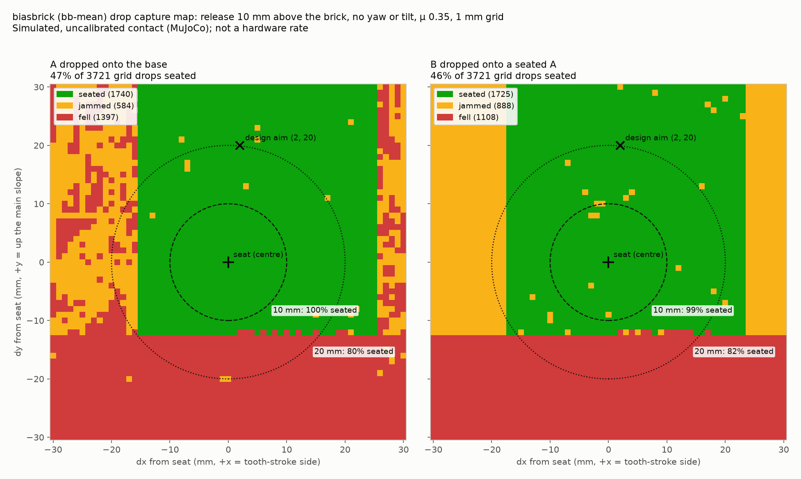

# biasbrick drop grid: where can the brick be released and still seat?

Simulated, uncalibrated contact (MuJoCo); not a hardware rate. Produced 2026-10-30 on `master` at
`d24086e` with a throwaway script (not kept in the repo).

## What was done

The final biasbrick design (`biasbrick/configs/bb-mean.json`) was dropped from every point of a 1 mm
grid, dx and dy from -30 to +30 mm around the **seat** (3,721 drops per case), in two cases:

- **A onto the base** (`on_brick=False`)
- **B onto an ideally seated A** (`on_brick=True`)

Each drop reuses `biasbrick.trials.drop_trials` with `offsets`: no yaw, roll, pitch or velocity, and
the brick's lowest point released **10 mm above whatever sits under it** at that offset
(`clear = 10`, see `trials.release_lift`). Physics is the CLI default: μ 0.35, timestep 1 ms,
contact time constant 4 ms. Outcomes use brixzle's tolerances: `seated`, `jammed` (came to rest
but out of tolerance) or `fell` (reached the floor).

`drop-grid.csv` has one row per drop: case, offset, outcome, the final position error in the
seat frame and the final angle.

## What it shows

| Case | Grid seated | Within 10 mm of the seat | Within 20 mm |
|---|---|---|---|
| A onto the base | 1740 / 3721 (47%) | 100% (317 cells) | 80% (1257 cells) |
| B onto a seated A | 1725 / 3721 (46%) | 99% (317 cells) | 82% (1257 cells) |

- **Y:** anything below dy of about -12 mm falls off the near (-y) side. Up the slope (+y), drops
  seat to the edge of the grid; the main slope and flange run on past +30 mm, so the band is wider than
  shown. This is why the design aims at (2, 20) mm rather than at the seat.
- **X:** B onto A seats from about -17 to +23 mm and jams outside that. A onto the base seats from about
  -15 to +25 mm, with a mix of jams and falls outside.
- Isolated orange cells inside the green band are single jams. Their cause was not investigated.

The grid percentages depend on the grid's extent, so read the map, not the totals. The 10 and 20 mm
circles are centred on the seat, not on the design aim.
