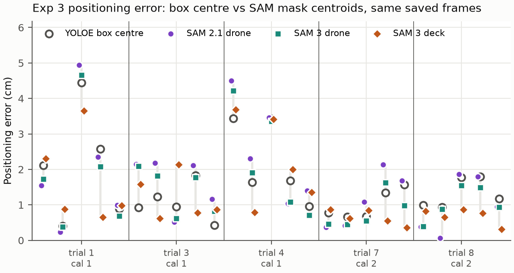

# Exp 3: Crazyflie X-Y approach accuracy (issue #24)

Raw data and first figures, for discussion. Nothing has been excluded or re-weighted yet.

## What was done

The Crazyflie takes off from its launch pad, hovers 5 s with its Lighthouse deck over the centre
of each of the 5 floor AprilTags, then lands. Each trial is one such route, so 5 approaches. We
flew **5 trials (25 approaches)** on 2026-10-22, in `--demo` mode (PID controller), session
`exp3-s2`.

Two errors are measured over each 5 s hover, in X-Y only:

- **Positioning error:** where the overhead D455 camera sees the deck, minus the tag centre. The
  camera pose is refit to the floor tags every frame, so the cage moving does not bias it. This is
  the error a pickup actually experiences.
- **Control error:** where Lighthouse says the drone is, minus where it was commanded to go. This
  shows how well the controller tracks its own position estimate.

## Results so far

| Data | Positioning: mean / RMSE / max | Control: mean / RMSE / max |
|---|---|---|
| All 5 trials (25 approaches) | 1.54 / 1.75 / 4.2 cm | 0.96 / 1.55 / 5.0 cm |
| Calibration 1: trials 1, 3, 4 | 1.74 / 2.01 / 4.2 cm | 1.40 / 1.98 / 5.0 cm |
| Calibration 2: trials 7, 8 | 1.24 / 1.27 / 1.7 cm | 0.30 / 0.35 / 0.6 cm |

Per-tag numbers are in [`summary.csv`](summary.csv).

## Points for discussion

1. **The Lighthouse calibration drifted during calibration 1.** Before each takeoff we compare
   where Lighthouse and the camera put the resting drone. That offset grew from 3.5 to 10.9 to
   17.0 mm over trials 1, 3 and 4. The next two attempts could not hold a stable position, and a
   live check then showed the two base stations disagreeing by about 4.5 cm. After recalibrating
   (calibration 2) the offset was 1–2 mm, and control error fell from 1.40 to 0.30 cm. The most
   likely cause is the base stations moving with the cage when someone steps in to reset the
   drone. Since then, every flight checks the stations against their calibration first
   (residuals 0.41 and 0.44 mrad against a 1.5 mrad limit).
2. **What to report.** All 5 trials together (realistic for this rig), calibration 2 only (2
   trials, a clean setup), or more trials on a stable setup.
3. **Tag 3 is the worst** (positioning 2.3 cm, control 2.6 cm mean). It is the far corner from the
   calibration placements, and it was most affected by the drifting calibration.
4. **Positioning error stays at about 1.2 cm even with a good calibration**, while control error
   drops to 0.3 cm. The remaining gap is between where Lighthouse thinks the drone is and where it
   really is, plus camera measurement error (see limitations).
5. **Trial count.** 5 trials, not the planned 20. A charge gives 2–3 flights before the 3.8 V
   preflight minimum, and the cage needs a recalibration whenever it is disturbed. Jitter at rest
   was under 1 mm on the fresh calibration, so the earlier growth in jitter looks like station
   drift rather than battery (see [`../lighthouse-rest-jitter.md`](../lighthouse-rest-jitter.md)).

## Box centre vs SAM mask centroids (#26)

Does measuring the drone with a segmentation mask, rather than the YOLOE box centre, close the
positioning gap? Offline re-run on the same flights, three ways, each pixel centroid cast onto the
same median-depth plane as the box centre:

- **SAM 2.1 drone:** SAM 2.1 (base), prompted with each logged YOLOE box: a whole-drone mask.
- **SAM 3 drone:** the same with SAM 3.
- **SAM 3 deck:** SAM 3 concept segmentation of the Lighthouse deck only. SAM 3 takes exemplar boxes
  in the image it segments, so each frame's crop is placed beside a reference crop with one
  hand-drawn deck box (`trial-07/hover-0074.png`). The best detection whose centroid is inside the
  YOLOE box is kept; 5 of 370 frames have none.

Only the frames saved during the flights (1 per second) have images, so all methods are compared
on those frames: 2–5 per approach instead of 9–14. On them the box centre is within 0.1 cm (mean)
of the full-rate result above.

| Positioning error, same saved frames: mean / RMSE / max (cm) | Box centre | SAM 2.1 drone | SAM 3 drone | SAM 3 deck |
|---|---|---|---|---|
| All 5 trials (25 approaches) | 1.54 / 1.83 / 4.4 | 1.66 / 2.06 / 4.9 | 1.49 / 1.86 / 4.7 | 1.29 / 1.63 / 3.7 |
| Calibration 1: trials 1, 3, 4 | 1.80 / 2.14 / 4.4 | 2.06 / 2.44 / 4.9 | 1.86 / 2.25 / 4.7 | 1.71 / 2.02 / 3.7 |
| Calibration 2: trials 7, 8 | 1.17 / 1.24 / 1.8 | 1.07 / 1.29 / 2.1 | 0.93 / 1.04 / 1.6 | 0.67 / 0.69 / 0.9 |

Per approach: [`methods.csv`](methods.csv); summary: [`methods-summary.csv`](methods-summary.csv).

**Reading:**

1. **The deck centroid is the most promising, but not yet conclusive.** With the fresh calibration
   it gives 0.67 cm mean and 0.87 cm max, against 1.17 and 1.80 cm for the box. It beats the box on
   8 of 10 of those approaches (sign test p ≈ 0.11) and on 14 of 25 overall (p ≈ 0.69). Calibration
   1 is dominated by the drifting Lighthouse calibration, so no centring method helps much there.
2. **Whole-drone centres carry a position-dependent bias; the deck centre does not.** The SAM 2.1
   drone centroid differs from the box centre by 0.9 cm on average, consistently per tag (tag 1:
   +1.3 cm in Y every time), and that shift points away from the point below the camera (mean
   cosine 0.82 with the outward direction). For SAM 3 drone masks the alignment falls to 0.46, and
   for the deck to 0.00. So most of the whole-drone shift is how the outline is seen, not where the
   drone is.
3. **The YOLOE box itself is sometimes off the drone.** Where the deck and box centres disagree most
   (up to 19 px, about 3.6 cm), the box is pulled toward the cage frame or a shadow and the deck
   centroid sits on the body.
4. **The masks are imperfect** (every 10th frame: [`mask-examples-sam2.1_b.png`](mask-examples-sam2.1_b.png),
   [`mask-examples-sam3.png`](mask-examples-sam3.png), [`mask-examples-sam3-deck.png`](mask-examples-sam3-deck.png)).
   Whole-drone masks sometimes drop a prop guard next to a tag or the cage frame, or include the
   white tag under the drone (which flatters the result); SAM 3 does both too, though its outlines
   look tighter (checked by eye, not measured). Deck
   masks are weak on the orange launch pad, outside the measured dwells. No frames are excluded
   beyond the deck-inside-box rule.
5. **None of this is ground truth.** All methods are compared with the surveyed tag centres, and
   the camera measurement is what is in question. The deck mask may also be biased by the bright
   LEDs on one side of the deck. A static test with the drone placed at measured positions would
   settle which centre is right.
6. **The frames have the YOLOE box drawn on them** (#29). Untouched, SAM segments the drawn
   rectangle, so its exact pixels are inpainted first. Clean frames from #29 would remove this step.

Rebuild: `segment_frames.py` (needs the frames in `runs/exp3-s2` and the `yolo` extra) writes
`data/trial-NN/masks-<method>.json`, then `make_figures.py` picks them up. SAM 3 weights are gated
(`hf download facebook/sam3 sam3.pt --local-dir runs/models` after access is granted). The deck mode
ran on a 6 GB laptop GPU in 77 s; on CPU, loading SAM 3 needs about 7 GB of free RAM.

## Known limitations

- Drone tilt is ignored; the camera measures the visual centre of the drone, not the deck sensor
  centre. A SAM 3 deck centroid may reduce positioning error (see above), but without ground truth.
- Each per-tag value rests on 5 approaches (2 for calibration 2 alone).
- Z is not evaluated.

## Files

- `approaches.csv`: one row per approach, with both errors (cm), positions (m), calibration and
  frame counts.
- `trials.csv`: every attempt (including the 3 that did not fly), with battery voltage, station
  check residual and pad offset.
- `summary.csv`: n, mean, RMSE, std, max and bias for each error, overall and per tag, pooled and
  per calibration.
- `data/`: raw session files and full event logs (gzipped) for every attempt. `.gitattributes` hides
  them from diffs. Routes are not kept; the originals stay in `runs/`.
- `methods.csv`, `methods-summary.csv`, `positioning-methods.png`, `mask-examples-*.png`: the #26
  box-vs-mask comparison.
- `segment_frames.py`: SAM mask centroids from the saved frames in `runs/` into
  `data/trial-NN/masks-<method>.json`; usage in its docstring.
- `make_figures.py`: rebuilds everything above from `data/`:
  `uv run --project flight --extra plot python figures/exp3-approach-accuracy/make_figures.py`.
