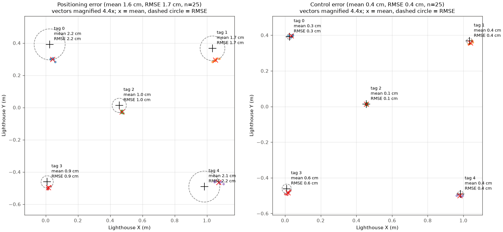

# Exp 3: Crazyflie X-Y approach accuracy (issues #24, #35)

Raw data and figures, for discussion. Nothing has been excluded or re-weighted beyond the trials
that did not fly.

## What was done

The Crazyflie takes off from its launch pad, hovers 5 s with its Lighthouse deck over the centre
of each of the 5 floor AprilTags, then lands. Each trial is one such route, so 5 approaches. We
flew **5 trials (25 approaches)** on 2026-10-23, in `--demo` mode (PID controller), session
`exp3-r2`, all on one calibration (setup `runs/setup-exp3-r2`). This replaces the 2026-10-22
session (`exp3-s2`), whose calibration drifted between trials.

Two errors are measured over each 5 s hover, in X-Y only:

- **Positioning error:** where the overhead D455 camera sees the deck, minus the tag centre. The
  camera pose is refit to the floor tags every frame, so the cage moving does not bias it. This is
  the error a pickup actually experiences.
- **Control error:** where Lighthouse says the drone is, minus where it was commanded to go. This
  shows how well the controller tracks its own position estimate.

## Results

| Data | Positioning: mean / RMSE / max | Control: mean / RMSE / max |
|---|---|---|
| All 5 trials (25 approaches) | 1.58 / 1.69 / 2.73 cm | 0.35 / 0.39 / 0.75 cm |

Per-tag numbers are in [`summary.csv`](summary.csv).

The tag survey the positioning error is measured against (drone on its pad, all 5 tags outlined):
[`data/survey.png`](data/survey.png).

## Points for discussion

1. **The calibration held for the whole session.** Station check residuals stayed at 0.12–0.17
   mrad (limit 1.5 mrad) and the Lighthouse-vs-camera pad offset at 2.4–7.4 mm, with no upward
   trend across trials (`trials.csv`).
2. **Positioning error is mostly a fixed offset per tag, not scatter.** Each tag's 5 approaches
   cluster tightly (positioning std 0.13–0.49 cm per tag), but the clusters sit 0.9–2.2 cm from
   the tag centre in different directions per tag: tags 0 and 4 about 2.2 cm, tags 2 and 3 about
   1 cm. Control error is small everywhere (0.13–0.58 cm mean per tag), so the drone goes where
   Lighthouse says it should; the gap is between the Lighthouse frame and where the camera puts
   the tags and the deck. Candidates are the Lighthouse geometry away from the calibration
   placements and the camera's deck-centre measurement (#34, #26); this data cannot separate them.
3. **Trial count.** 5 trials, not the planned 20. Of 7 attempts, trial 4 stopped at preflight
   (battery 3.78 V, below the 3.8 V minimum) and trial 6 stopped on stale camera observations.

## Known limitations

- Drone tilt is ignored; the camera measures the visual centre of the drone, not the deck sensor
  centre.
- Each per-tag value rests on 5 approaches.
- Z is not evaluated.

## Files

- `approaches.csv`: one row per approach, with both errors (cm), positions (m), calibration and
  frame counts.
- `trials.csv`: every attempt (including the 2 that did not fly), with battery voltage, station
  check residual and pad offset.
- `summary.csv`: n, mean, RMSE, std, max and bias for each error, overall and per tag.
- `data/`: raw session files, the tag-survey image and full event logs (gzipped) for every
  attempt. `.gitattributes` hides them from diffs. Routes are not kept; the originals stay in `runs/`.
- `make_figures.py`: rebuilds everything above from `data/`:
  `uv run --project flight --extra plot python figures/exp3-approach-accuracy/make_figures.py`.
