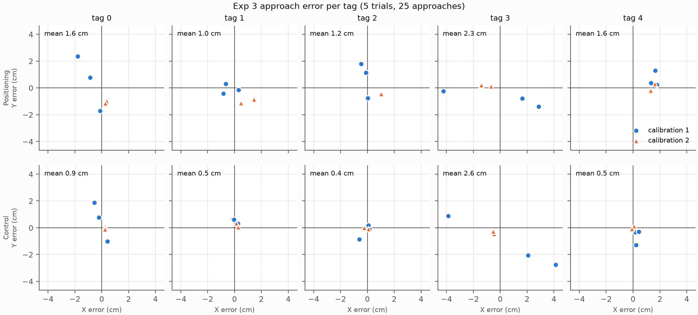
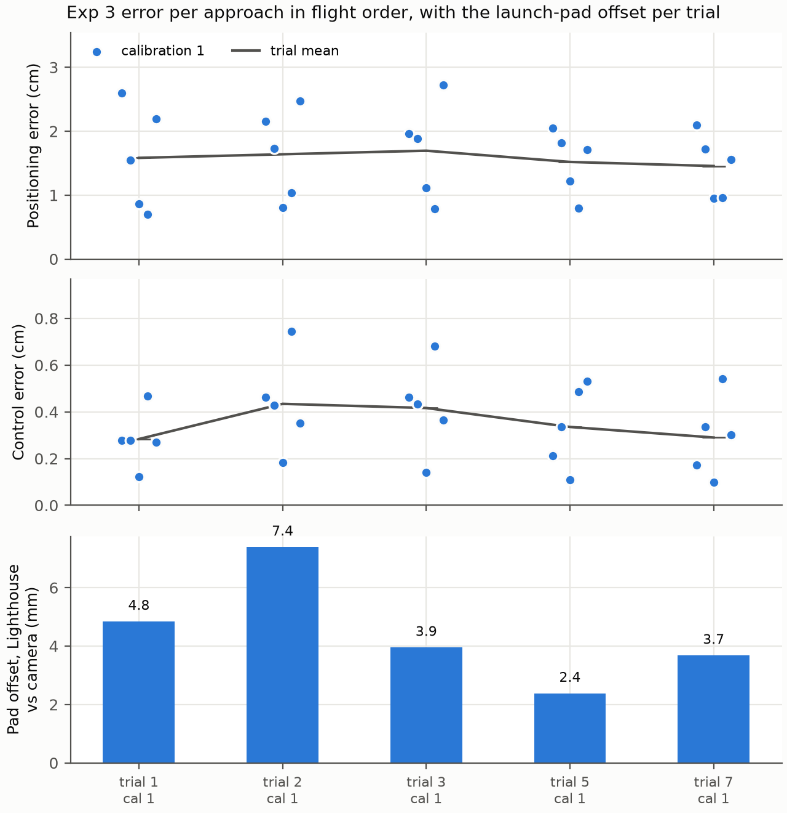

# Exp 3: Crazyflie X-Y approach accuracy (issue #24)

Raw data and first figures, for discussion. Nothing has been excluded or re-weighted yet.

## What was done

The Crazyflie takes off from its launch pad, hovers 5 s with its Lighthouse deck over the centre
of each of the 5 floor AprilTags, then lands. Each trial is one such route, so 5 approaches. We
flew **5 trials (25 approaches)** on 2026-10-22, in `--demo` mode (PID controller), session
`exp3-s2`.

Two errors are measured over each 5 s hover, in X-Y only:

- **Positioning error:** where the overhead D455 camera sees the deck, minus the tag centre. The
  camera pose is refit to the floor tags every frame, so the cage moving does not bias it. This is
  the error a pickup actually experiences.
- **Control error:** where Lighthouse says the drone is, minus where it was commanded to go. This
  shows how well the controller tracks its own position estimate.

## Results so far

| Data | Positioning: mean / RMSE / max | Control: mean / RMSE / max |
|---|---|---|
| All 5 trials (25 approaches) | 1.54 / 1.75 / 4.2 cm | 0.96 / 1.55 / 5.0 cm |
| Calibration 1: trials 1, 3, 4 | 1.74 / 2.01 / 4.2 cm | 1.40 / 1.98 / 5.0 cm |
| Calibration 2: trials 7, 8 | 1.24 / 1.27 / 1.7 cm | 0.30 / 0.35 / 0.6 cm |

Per-tag numbers are in [`summary.csv`](summary.csv).

## Points for discussion

1. **The Lighthouse calibration drifted during calibration 1.** Before each takeoff we compare
   where Lighthouse and the camera put the resting drone. That offset grew from 3.5 to 10.9 to
   17.0 mm over trials 1, 3 and 4. The next two attempts could not hold a stable position, and a
   live check then showed the two base stations disagreeing by about 4.5 cm. After recalibrating
   (calibration 2) the offset was 1–2 mm, and control error fell from 1.40 to 0.30 cm. The most
   likely cause is the base stations moving with the cage when someone steps in to reset the
   drone. Since then, every flight checks the stations against their calibration first
   (residuals 0.41 and 0.44 mrad against a 1.5 mrad limit).
2. **What to report.** All 5 trials together (realistic for this rig), calibration 2 only (2
   trials, a clean setup), or more trials on a stable setup.
3. **Tag 3 is the worst** (positioning 2.3 cm, control 2.6 cm mean). It is the far corner from the
   calibration placements, and it was most affected by the drifting calibration.
4. **Positioning error stays at about 1.2 cm even with a good calibration**, while control error
   drops to 0.3 cm. The remaining gap is between where Lighthouse thinks the drone is and where it
   really is, plus camera measurement error (see limitations).
5. **Trial count.** 5 trials, not the planned 20. A charge gives 2–3 flights before the 3.8 V
   preflight minimum, and the cage needs a recalibration whenever it is disturbed. Jitter at rest
   was under 1 mm on the fresh calibration, so the earlier growth in jitter looks like station
   drift rather than battery (see [`../lighthouse-rest-jitter.md`](../lighthouse-rest-jitter.md)).

## Known limitations

- Drone tilt is ignored; the camera measures the visual centre of the drone, not the deck sensor
  centre.
- Each per-tag value rests on 5 approaches (2 for calibration 2 alone).
- Z is not evaluated.

## Files

- `approaches.csv`: one row per approach, with both errors (cm), positions (m), calibration and
  frame counts.
- `trials.csv`: every attempt (including the 3 that did not fly), with battery voltage, station
  check residual and pad offset.
- `summary.csv`: n, mean, RMSE, std, max and bias for each error, overall and per tag, pooled and
  per calibration.
- `data/`: raw session files and full event logs (gzipped) for every attempt. `.gitattributes` hides
  them from diffs. Routes are not kept; the originals stay in `runs/`.
- `make_figures.py`: rebuilds everything above from `data/`:
  `uv run --project flight --extra plot python figures/exp3-approach-accuracy/make_figures.py`.
