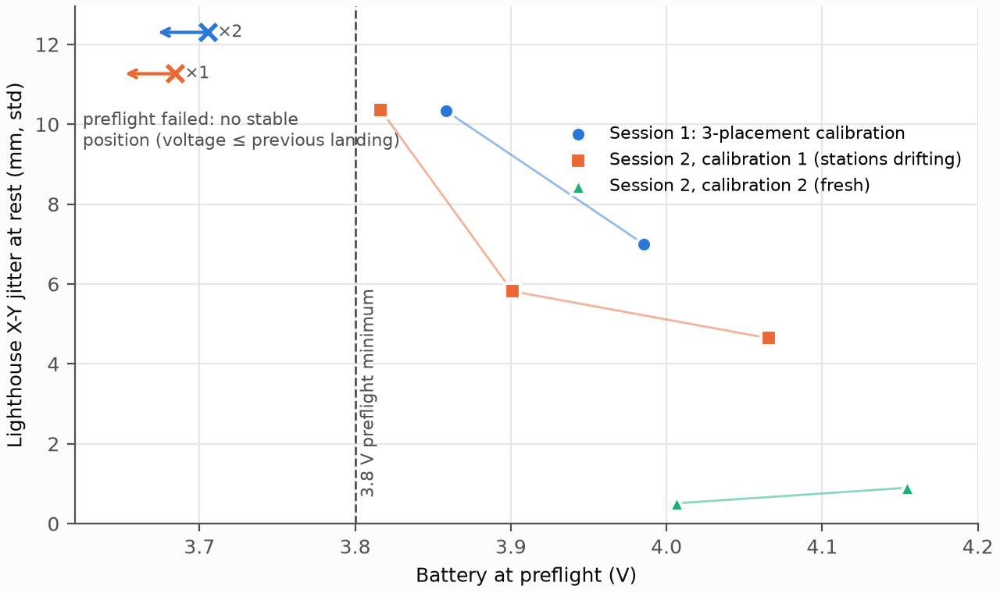

# Lighthouse jitter at rest: calibration drift, then battery

Data: [`lighthouse-rest-jitter.csv`](lighthouse-rest-jitter.csv). Regenerate both with
`uv run --project flight --extra plot python figures/lighthouse_rest_jitter.py` (it reads the
local flight logs in `runs/`, which are not checked in; the Exp 3 logs are also kept in
`exp3-approach-accuracy/data/`).

## What was measured

Before each Exp 3 trial, the Crazyflie rests on its launch pad while preflight runs. We take the
standard deviation of the Lighthouse X-Y position estimate (20 Hz) over the roughly 1.2 s between
preflight and takeoff. Voltage is the battery reading at preflight, at rest.

## What the data shows

- **With a fresh calibration, jitter at rest is under 1 mm:** 0.9 mm at 4.15 V and 0.5 mm at
  4.01 V (session 2, calibration 2).
- **On older or drifting calibrations it was 5–10 mm, and grew trial by trial.** Over the same
  trials, the base stations were moving: the launch-pad offset between Lighthouse and the camera
  grew from 3.5 to 10.9 to 17.0 mm across trials 1, 3 and 4. A live check afterwards showed the two
  stations disagreeing by about 4.5 cm. The stations are most likely disturbed when someone steps
  into the cage to reset the drone.
- **The battery drained during those same trials,** so on calibration 1 the two effects cannot be
  separated. The fresh calibration shows no rise between 4.15 and 4.01 V, but it has only two
  flights and none below 4.0 V.
- **Preflight failures:** three attempts failed after flights that landed at 3.68–3.71 V. A
  fourth (session 2, trial 6, 3.9 V battery) was a moved station, not the battery; it is excluded
  here.

## Consequence for the protocol

- **Main cause: station calibration.** Every flight now checks, before preflight, that the
  stations still match their calibration, and stops with "re-run setup" if not. The session can
  then be continued on the new calibration.
- **Battery is a practical limit, not a demonstrated cause of jitter.** Each 85 s trial draws
  about 0.15–0.2 V, so a charge gives two to three trials before the 3.8 V preflight minimum.
  Preflight now checks the battery first, so a flat battery is reported as such.
- **Why 5 trials, not 20:** battery swaps, plus recalibrating whenever the cage is disturbed, make
  each trial slow to obtain. That is a logistics argument. The data here do not show that later
  trials on a charge are less accurate once the calibration is sound, and 5 trials gives only 5
  approaches per tag.

## Caveats

- Small sample: 7 flights, plus 3 failed preflights.
- The rest window is short (about 25 samples), so each value is uncertain by roughly ±15%.
- Failed attempts never took off, so they have no jitter value. Their voltage is bounded above by
  the previous flight's landing voltage.
